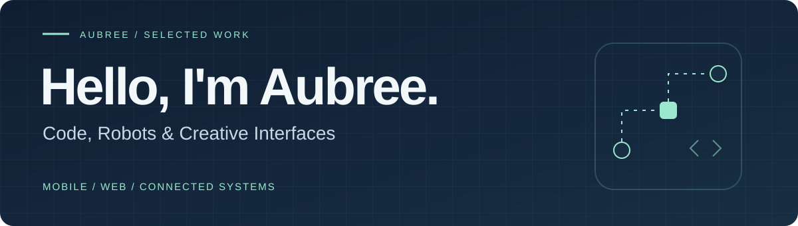
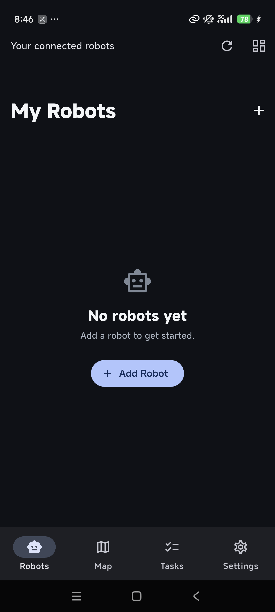
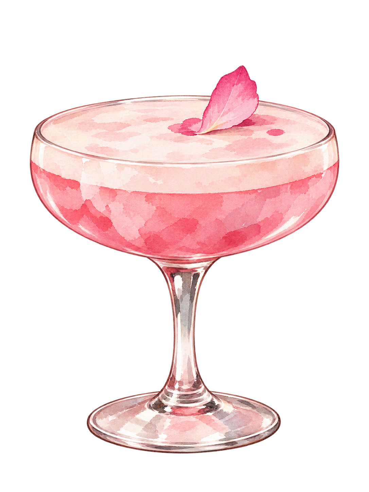
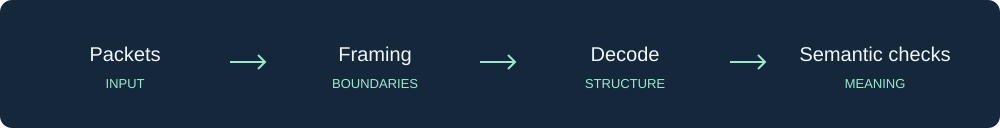

  

  <a href="#selected-work">Selected work</a> ·
  <a href="#toolkit">Toolkit</a> ·
  <a href="https://github.com/aubreedaimian-star?tab=repositories">All repositories</a>

I build robot-control tools and interactive web experiences, with an interest in connected systems. My projects bring together device communication, interface design and hands-on experimentation.

软件开发 · 机器人交互 · 创意前端

## Selected work

### 01 / My Robots

**From device setup to a working control interface.**

An Android-focused Flutter prototype that brings BLE Wi-Fi provisioning, LAN discovery, manual control and work-map interaction into one application. A built-in simulator supports development without a physical robot.

View the Android interface

 

Existing Android development capture. Hardware compatibility requires separate validation.

`Flutter` `Dart` `Android` `BLE` `UDP`

**Explore:** [Source & setup](https://github.com/aubreedaimian-star/robot-control-flutter) · [Demo walkthrough](https://github.com/aubreedaimian-star/robot-control-flutter/blob/main/DEMO.md) · [Tests](https://github.com/aubreedaimian-star/robot-control-flutter/tree/main/test)

APPLICATION PROTOTYPE · Simulator available · Physical-device validation remains separate

---

### 02 / Aubree After Hours

**A creative identity, translated into an interactive website.**

A cocktail-inspired portfolio with an illustrated, animated stage. The project explores motion, composition and reusable typed content, with tests for stage geometry and image contact points.

View a cocktail illustration from the project

 

Project artwork preview, not a screenshot of a deployed website.

`Next.js` `React` `TypeScript` `Tailwind CSS` `Framer Motion`

**Explore:** [Source & setup](https://github.com/aubreedaimian-star/aubree-after-hours) · [Demo walkthrough](https://github.com/aubreedaimian-star/aubree-after-hours/blob/main/DEMO.md) · [Geometry tests](https://github.com/aubreedaimian-star/aubree-after-hours/tree/main/components/hero)

FRONTEND PROTOTYPE · Source available · Live deployment not yet published

---

### 03 / V2X Message Processing

**Looking beyond successful parsing to correct message semantics.**

An engineering case study of a Java/Maven message-processing project and its offline decoder-validation workflow. It discusses packet boundaries, ASN.1 decoding and compatibility limits.

  

`Java` `Maven` `MQTT` `Apache Flink` `ASN.1`

**Explore:** [Read the case study](https://github.com/aubreedaimian-star/v2x-case-study)

DOCUMENTATION ONLY · Original research source, data and decoder binaries are not distributed

## Toolkit

| Area | Tools used in these projects |
| :--- | :--- |
| Mobile & device interfaces | Flutter · Dart · Android · BLE · UDP |
| Interactive web | React · Next.js · TypeScript · Tailwind CSS · Framer Motion |
| Message-processing case study | Java · Maven · MQTT · Apache Flink |
| Development workflow | Git · unit tests · widget tests · offline validation |

## What connects the work

I'm interested in how software connects to the world: a robot reporting its state, a message arriving intact, or an interface making an unfamiliar system easier to use.

Each repository includes its current scope, setup or case-study notes, and known limitations. Start with **My Robots** for device-oriented software, **Aubree After Hours** for frontend work, or **V2X** for the validation case study.
